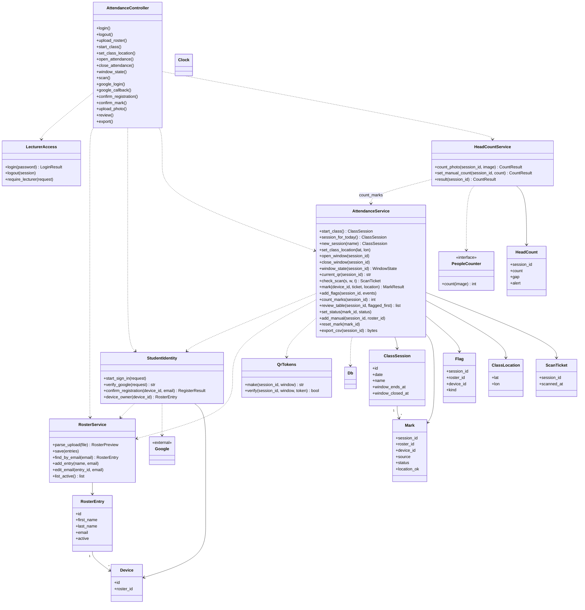
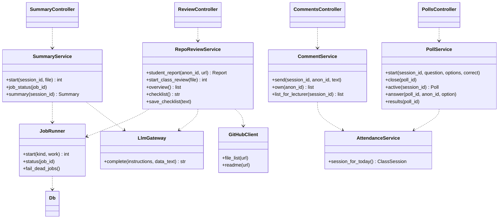
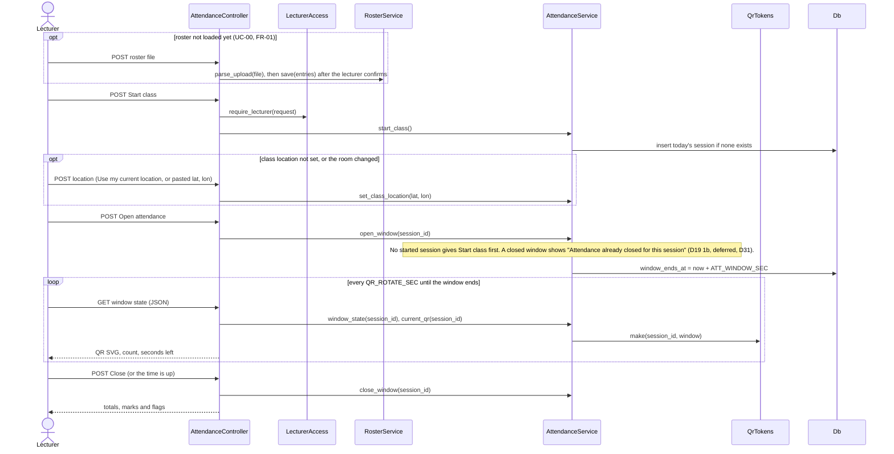
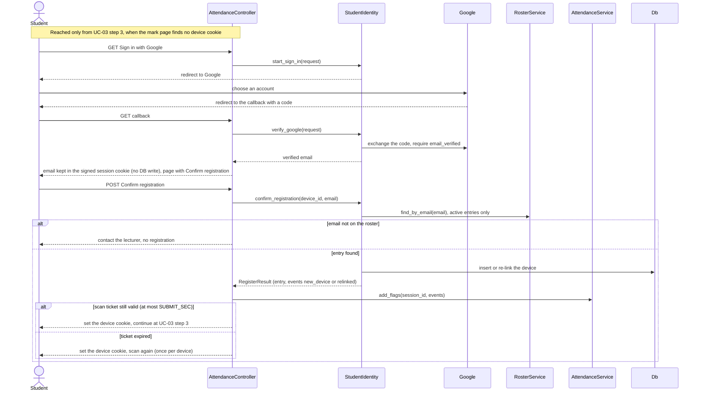
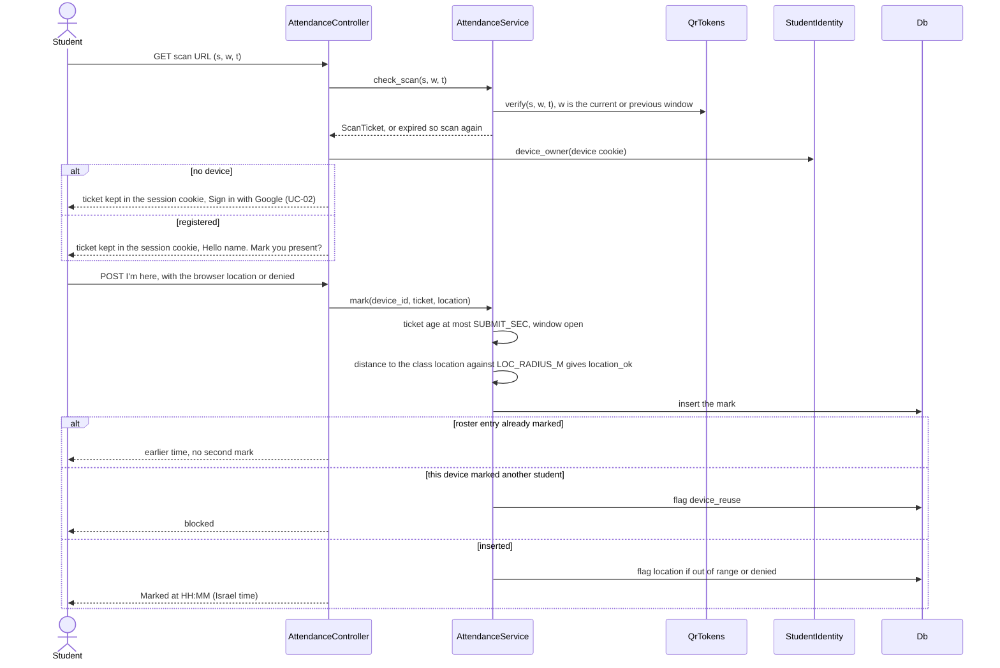
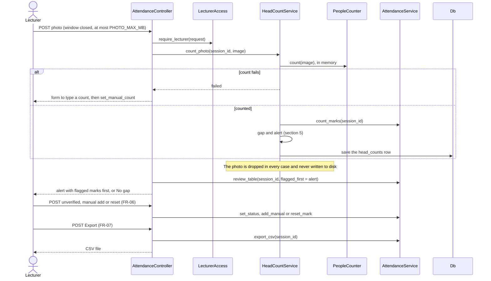
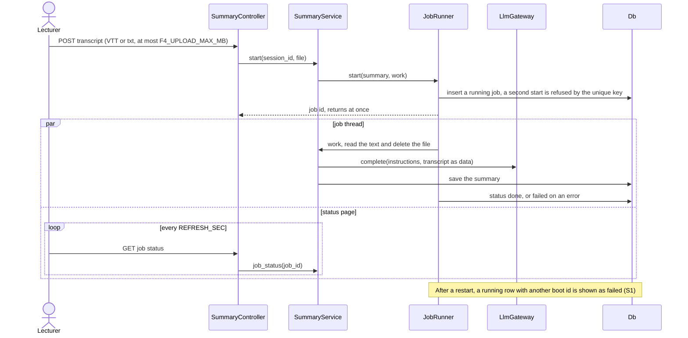

# Engineering Design Document

Status: draft. Date: 21/11/2026. Read with `sdd.md`, `srs.md` and `decisions.md` (D1-D28). IDs follow D20.
Tags: [A] assignment, [SRS], [SDD], [UC] `use_cases.md`, [Dn] decision, [U21] my answer 21/11/2026, [S1] spike S1 (`results.md`), [code] checked in the installed library, [P] proposal (not a decision), [U22] my answer 22/11/2026.

## 1. Scope and stack

- This EDD gives the low-level class and sequence diagrams [A], the schema and the session details that the SDD leaves to it (sdd.md:4). F1 (FR-01 to FR-07) is in depth; F2-F3 are short; F4-F5 are thin [D6].
- Stack: Python 3.13, FastAPI, uvicorn with one worker, SQLite through plain `sqlite3` (no ORM), Jinja2 pages with a little JS for polling, Authlib for Google sign-in, `segno` for the QR (not verified) [U21, S1]. Host: Railway Hobby with a usage limit [U21, U22].
- One worker is required, because the job boot-id rule and the in-memory login counter depend on it [U21, S1]. Every data-changing action is a POST, and no GET writes to the database [U21, S1].
- C-01 is five thin controllers with routes only and no logic [U21]. Each other component is one service class with its SQL in private methods [U21]. One `app/` package with one module per component (for example `roster.py`, `attendance.py`); tests in `tests/` [U22].
- Infrastructure classes (not components) [U21]: `Settings` (env vars and parameters), `Db` (one sqlite3 connection per call; creates the tables), `Clock` (UTC now, Israel time for display; set in tests), `JobRunner` (the S1 job design).
- Times are stored in UTC and shown in Israel time [U21]. A session date is the Israel date [P].

## 2. Class diagrams

### 2.1 F1 (C-01 to C-06)

All services also use `Db` and `Clock`; those arrows are left out.

- C-06 calls C-05 `count_marks()`. C-05 never calls C-06 [SDD:48, U21]. For "flagged first", the controller asks `HeadCountService.result()` and passes the alert to `review_table()`.
- `PeopleCounter` hides the count method. Option A or B stays OPEN until S4 [SDD:134].
- `RegisterResult` carries the roster entry and the events (`new_device`, `relinked`). The controller passes them to `add_flags()`, so C-04 never calls C-05 [P].
- `new_session(name)` is deferred (1b, D31).

### 2.2 F2-F5 (C-07 to C-11, Must methods only)

Entities: `Comment`, `Poll`, `Answer`, `Summary`, `Job`, `RepoResult`, `Checklist`; their fields are in section 3. Login and logout routes are in `AttendanceController` [U21].

## 3. Schema

SQLite, times as UTC ISO text [U21]. Fields and keys are [P] unless tagged. "Delete" means the end-of-semester script deletes the rows [SDD, D21].

| Table | Fields and keys | Owner | Delete |
|---|---|---|---|
| `roster_entries` | id PK, first_name, last_name, email UNIQUE (lower case), active, source (upload / manual), created_at | C-03 | yes |
| `devices` | id PK (the random cookie value), roster_id FK, created_at | C-04 | yes |
| `class_sessions` | id PK, date, name (null; D19), window_opened_at, window_ends_at, window_closed_at. No unique date: D19 1b allows a second session | C-05 | yes |
| `marks` | id PK, session_id FK, roster_id FK, device_id (null if manual), marked_at, source (self / manual), status (normal / unverified), location_ok (1 / 0 / null). UNIQUE(session_id, roster_id); UNIQUE(session_id, device_id) where device_id is not null | C-05 | yes |
| `flags` | id PK, session_id FK, roster_id, device_id, kind (new_device / relinked / device_reuse / location), created_at | C-05 | yes |
| `class_location` | id = 1, lat, lon, updated_at [U21] | C-05 | **no** [U21] |
| `head_counts` | session_id PK FK, count, source (auto / manual), marks_at_count, gap, alert, created_at | C-06 | yes |
| `comments` | id PK, session_id FK, anon_id, text, hidden, created_at | C-07 | yes |
| `polls` | id PK, session_id FK, question, options_json, correct_index (null), status (open / closed), created_at, closed_at. UNIQUE(status) where status = 'open' | C-08 | yes |
| `poll_answers` | PK(poll_id, anon_id), option_index, created_at [FR-11] | C-08 | yes |
| `summaries` | id PK, session_id FK, text, created_at | C-10 | yes |
| `jobs` | id PK, kind (summary / class_review), status, progress, total, boot_id, created_at, finished_at, error. UNIQUE(kind) where status = 'running' [S1, U21] | JobRunner | yes [U21] |
| `repo_results` | id PK, job_id FK, repo_url, accessible, layer1_json, ratings_json, flags, created_at. No emails [FR-14] | C-11 | yes |
| `f5_reports` | id PK, anon_id, created_at. Gives the per-browser interval and the daily cap by date [SDD:90] | C-11 | yes |
| `checklist` | id = 1, text, updated_at | C-11 | **no** [D21] |

- The login attempt counter is not stored; it lives in memory in `LecturerAccess` [U21].
- Uploaded files (roster, photo, transcript, submissions list) are never stored in a table. They are deleted after processing, also on failure [D21, SDD:90]. The photo is read in memory only [P].
- Registration looks only at active roster entries. Marking checks only the device link [U21].

## 4. Sequences

The actors (Lecturer, Student) are people; every other participant is a class in section 2.

### 4.1 UC-01 Run an attendance window (with Start class)

The location control sits on the Start class page: a "Use my current location" button (browser geolocation) and a text field for "lat, lon" copied from Google Maps [U21].

### 4.2 UC-02 Register device

### 4.3 UC-03 Mark attendance

### 4.4 UC-04 Class photo count (and UC-05 review)

### 4.5 F4 background job (UC-10)

## 5. Algorithms

- **QR token** [U21; details P]: w = floor(now / `QR_ROTATE_SEC`); t = HMAC-SHA256(`SECRET_KEY`, "session_id:w"), first 16 hex characters. A scan is accepted when t matches (constant-time compare), w is the current or previous window, and the window is open.
- **Scan ticket** [U21]: {session_id, scanned_at} in the signed session cookie. A mark is accepted while now - scanned_at is at most `SUBMIT_SEC` (60, initial value, proposal). If the ticket expires during the first Google sign-in, the student scans again, once per device.
- **Distance** [U21; formula P]: haversine distance from the browser location to the class location; location_ok = distance at most `LOC_RADIUS_M`. Location denied gives 0 and a flag (UC-03 5d). No class location set: no check, location_ok null, and a warning on the lecturer page [P, approved 21/11, to confirm in S3].
- **Count gap** [P]: marks = all marks of the session when the count is made; gap = marks - count; alert when marks > count x (1 + `GAP_TOLERANCE_PCT` / 100). Example (UC-04): 104 marks, 97 counted, limit 101.85, so the alert fires.
- **Roster replace** [P]: entries are matched by lower-case email. Entries missing from the new file become inactive and are kept, so old marks keep their name (FR-01).
- **Export** [U21]: CSV, UTF-8 with BOM; columns name, email, time, source, status, flags (FR-07).

## 6. Cookies, login and jobs

| Cookie | Holds | Lifetime | Source |
|---|---|---|---|
| `session` (Starlette, signed with `SECRET_KEY`, https_only, SameSite Lax) | lecturer flag; Google sign-in state; verified email until Confirm registration; scan ticket | `LECTURER_SESSION_HOURS` = 8, `max_age` set explicitly (the default is 14 days) | U21; S1; code; name P |
| `device` | random id linked to a roster entry | `BROWSER_COOKIE_DAYS` = 120 | U21; name P |
| `anon` | random id for comments, polls and F5 limits; never stored with a device id or roster id | `BROWSER_COOKIE_DAYS` = 120 | U21 |

- `device` and `anon` are HttpOnly, Secure, SameSite Lax, like the S1 cookie test [P]. A cleared device cookie means signing in again and a `new_device` flag [D16]. The 120-day lifetime is not verified (S1 tested short gaps only).
- Starlette renews the signature timestamp only when the session changes [code].
- Login: after `LOGIN_ATTEMPT_LIMIT` = 5 wrong passwords, login is locked for everyone for `LOGIN_LOCKOUT_SEC` = 300 [U21; name P]. The counter is in memory and resets on restart [U21]. The password is compared in constant time [P]. Logout is a POST button on every lecturer page [U21].
- Jobs [S1, U21]: one `jobs` table for F4 and F5, one running job per kind, a thread in the same process, and a boot id per server run. A running row with another boot id is shown as failed. The page polls every `REFRESH_SEC`. The F5 student report is synchronous [SDD:86].

## 7. Errors

- A database error gives a short error page with status 500 [S1]. A wrong type or a file that is too large gives an error, and nothing is stored (UC-00 2a, UC-04 1a, UC-10 2a).
- A model failure makes the F4 job "failed"; F5 falls back to layer 1 (FR-13). A GitHub limit gives "Try again later" (UC-11 3b).
- Unique-key conflicts are normal answers, not errors: already marked, device reuse, second running job, second poll answer [P].

## 8. Configuration

- Parameter names and marks: SRS 3.4. Set on 22/11 [U22]: `QR_ROTATE_SEC` 10, `PHOTO_MAX_MB` 10, `LOAD_SIM_MARKS` 100 (initial values). The other OPEN values stay OPEN.
- Set on 21/11 and now in SRS 3.4 [U21]: `ATT_WINDOW_SEC` 300 and `SUBMIT_SEC` 60 (initial values, proposals); `LOGIN_ATTEMPT_LIMIT` 5; `LOGIN_LOCKOUT_SEC` 300, `LECTURER_SESSION_HOURS` 8 and `BROWSER_COOKIE_DAYS` 120 (names P). Decisions: D23-D28.
- Env vars, names only: `LECTURER_PASSWORD`, `SECRET_KEY`, `GOOGLE_CLIENT_ID`, `GOOGLE_CLIENT_SECRET`, `LLM_API_KEY`, `GITHUB_TOKEN` [SDD:107]; `BASE_URL`, `DB_PATH` [S1].
- The class location is a database setting, not an env var [U21].

## 9. Rejected alternatives

- Repository classes: rejected for KISS and length; they can be extracted later [U21].
- An ORM (SQLModel, SQLAlchemy); a frontend framework [U21].
- A queue system (Celery, Redis); synchronous F4 and F5 jobs [SDD, U21].
- Push with WebSockets [SDD].
- The login counter in the database; per-IP limits [U21].
- A GET that writes data, also for the Google callback [U21].
- QR state in server memory (the token is stateless) [SDD].
- The class location in env vars [U21].
- An LLM as the default head count; face recognition; a network (IP) check [U21, D2, D9].
- Backend-as-a-service [U21].

## 10. Tests

The strategy is in `stp.md` (TBD), with IDs `TC-nn` [D20]. Proposal: each service class is tested through its public methods on a temporary SQLite file with a set `Clock`; controllers through the FastAPI test client; `Google`, `PeopleCounter` and `LlmGateway` are replaced by fakes [P].

## 11. Check: FR-01 to FR-07

| FR | Classes | Tables | Sequence |
|---|---|---|---|
| FR-01 | RosterService | roster_entries | 4.1 (opt) |
| FR-02 | AttendanceService, QrTokens | class_sessions, class_location | 4.1 |
| FR-03 | StudentIdentity, RosterService, AttendanceService | devices, flags | 4.2 |
| FR-04 | AttendanceService, QrTokens, StudentIdentity | marks, flags, class_location | 4.3 |
| FR-05 | HeadCountService, PeopleCounter | head_counts | 4.4 |
| FR-06 | AttendanceService, RosterService | marks, roster_entries | 4.4 |
| FR-07 | AttendanceService | marks, roster_entries, flags | 4.4 |

F2-F5 in short: FR-08/09 CommentService, `comments`; FR-10/11 PollService, `polls`, `poll_answers`; FR-12 SummaryService, `summaries`, `jobs`, 4.5; FR-13/14/15/19/20 RepoReviewService and LlmGateway, `repo_results`, `jobs`, `checklist`, `f5_reports`; FR-16/18 controllers; FR-17 LecturerAccess (memory).

## 12. Open items

- S2: QR timing (`QR_ROTATE_SEC`, `SUBMIT_SEC`, `ATT_WINDOW_SEC`) and up to 100 simultaneous marks on one SQLite file. Not verified.
- S3: block or flag when out of range (FR-04). The "no class location set" rule is a proposal. **Risk:** laptop geolocation can be inaccurate when the lecturer uses "Use my current location" (not verified, test in S3).
- S4: the `PeopleCounter` implementation. S5, S6: the model provider and the F4 and F5 limits.
- Not verified: `segno`, the 120-day cookies, the WhatsApp in-app browser and the 100 test-user cap [S1].
