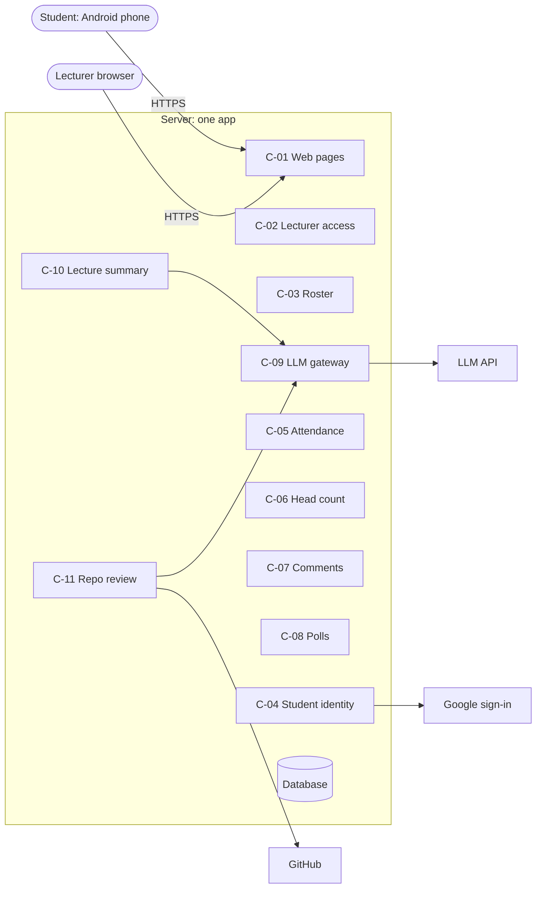
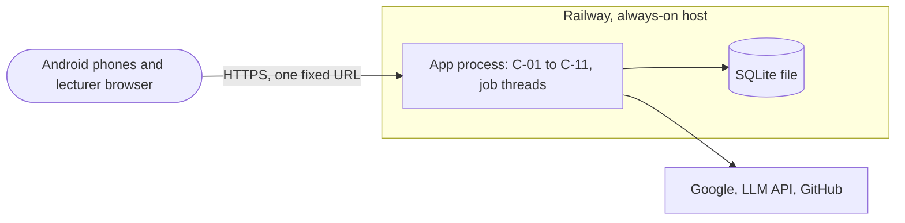

# Software Design Document

Status: draft. Date: 21/11/2026. Read with `srs.md` and `decisions.md` (D1-D28). IDs follow D20.
This SDD says how the system is split into components and how they connect. Requirements are in the SRS. Classes, sequences, schema and session details are in the EDD.

## 1. Context

Actors: the student (Android phone browser; iPhone not tested, not guaranteed) and the lecturer (any browser; a laptop is the main assumption, often projected).

| External system | Used by | How | Source |
|---|---|---|---|
| Google sign-in | C-04 | OAuth / OpenID Connect, through a library | D8; SRS 3.1 |
| Browser location | C-05 (through C-01) | browser API; the server computes yes/no | D9; FR-04 |
| LLM API | C-09 only (used by C-10, C-11) | HTTPS | D12, D13, D17 |
| GitHub, public repos, read-only | C-11 | HTTPS | D13; SRS 3.1 |

The head count runs on our server and is not an external system (D37). The audio extraction and transcription tool is optional (SRS Appendix C).

C-01 calls C-02 to C-11 through their service classes. All components use the database.

Other calls: C-05 uses C-04 (FR-04) and C-03 (FR-06, roster); C-04 uses C-03 (FR-03); C-06 gets the number of marks from C-05 (FR-05); C-10 and C-11 use C-09.

## 2. Principles

| Principle | Reason (rejected alternative) | Source |
|---|---|---|
| One modular web app, one process | One person, a few days (microservices) | proposal; project_plan.md:25 |
| Trust-sensitive checks on the server only | The browser can be changed (checks in the browser) | proposal; SRS 3.6 |
| All state in the database; the QR token is stateless (time-based, signed) | Memory is lost on restart (state in server memory) | proposal; project_plan.md:18, 63 |
| Lecturer pages poll; no push | Enough for a 20 s refresh, works on any host (WebSockets) | D10, D11; SRS B4 |
| LLM calls only through C-09 | One place for the spending limit and for treating README text as data (direct calls per feature) | proposal; FR-20, NFR-10 |
| F4 and F5 class review: a job row and a background thread | Required by FR-12, FR-14 (a separate queue system, e.g. Celery + Redis) | FR-12, FR-14 |
| Reuse libraries, build only the glue | Time; the assignment prefers other code (own code) | D17 |
| Secrets in environment variables | Public repo (secrets in code or config files) | D14, NFR-07 |
| One service class per component as its public interface, except C-01 (thin controllers with routes only); entity classes in the EDD | Testable per component (one class for everything) | proposal; C-01: own decision 21/11 |

## 3. Components

| ID | Component | Responsibility | FRs | Data owned |
|---|---|---|---|---|
| C-01 | Web pages | student class page, fixed QR, lecturer pages; routes requests | FR-16, FR-18 | none |
| C-02 | Lecturer access | one password (D14), attempt limit; session details: EDD | FR-17 | none (attempt counter in memory only, D26) |
| C-03 | Roster | load, validate and edit the roster | FR-01, FR-06 (roster edits) | roster entries |
| C-04 | Student identity | Google sign-in, browser-to-roster link, device flags | FR-03 | device links |
| C-05 | Attendance | sessions, window, rotating QR, marks, location yes/no, review, export | FR-02, FR-04, FR-06, FR-07 | sessions, attendance rows |
| C-06 | Head count | count people with YOLOX through OpenCV on our server (D37); gap alert; delete the photo | FR-05 | count and gap |
| C-07 | Comments | send, rate limit, list | FR-08, FR-09 | comments |
| C-08 | Polls | create, answer, close, results | FR-10, FR-11 | polls, answers |
| C-09 | LLM gateway | all LLM calls; input text is data; output in the input language | FR-20 | none |
| C-10 | Lecture summary | transcript job, summary | FR-12 | summaries (job rows: shared `JobRunner`, D25) |
| C-11 | Repo review | layer 1, layer 2 through C-09, class review job, checklist, limits, README cut | FR-13, FR-14, FR-15, FR-19, FR-20 (cut) | checklist, F5 overview, F5 counters (job rows: shared `JobRunner`, D25) |

Replacing Google sign-in after S1 changes only C-04.

## 4. Interfaces

Browser and server talk over HTTPS: HTML pages plus JSON for polled data (REST/JSON, lecture 04a). The attendance page polls every `QR_ROTATE_SEC` and gets the new QR and the live count in one response. Comments, poll counts and job status poll every `REFRESH_SEC`, with "Refresh now". Student pages do not poll (D11). Components call each other only through their service class.

Long-running work: F4 summary (FR-12) and F5 class review (FR-14) save a job row (status, progress) and run in a background thread in the same process; a job left "running" after a restart becomes "failed". The F5 student report (FR-13) is synchronous. `JOB_TIMEOUT_SEC` applies only to the optional recording input (SRS 3.4).

## 5. Data

Entities and retention follow SRS 3.5 and D21; the owner is the component in section 3. The end-of-semester delete is one documented script (proposal). F5 counters are keyed by date, so no reset job is needed (NFR-09). Uploaded files are deleted after processing, also on failure. Job rows are kept like D21 (SRS 3.5, D25); the login attempt counter is in memory only (D26). Fields and schema: EDD.

## 6. Deployment

Railway Trial, an always-on host with SQLite on a Volume (S1 done, D23).

Alternative: serverless with a hosted database. It changes the database and needs another way to run background jobs (rejected after S1, D23). Cloud service models: lecture 04a.
One fixed URL is needed: the Google redirect and the fixed class QR (FR-16) depend on it.
Environment variable names only: `LECTURER_PASSWORD`, `SECRET_KEY`, `GOOGLE_CLIENT_ID`, `GOOGLE_CLIENT_SECRET`, `LLM_API_KEY`, `BASE_URL`, `DB_PATH`, `GITHUB_TOKEN` (required unless S6 shows otherwise; about 60 unauthenticated requests per hour, not verified).

## 7. Traceability

Every FR-01 to FR-20 appears in section 3. FR-16 to FR-20 are cross-cutting or safeguard rows (SRS 1.5): FR-16 C-01; FR-17 C-02; FR-18 C-01; FR-19 C-11; FR-20 C-09 and C-11. The threat model stays in SRS 3.6.

| NFR | Component |
|---|---|
| NFR-01 | C-01 |
| NFR-02 | C-01, C-04, C-05 |
| NFR-03 | C-05 (S2) |
| NFR-04 | C-05, C-06 |
| NFR-05 | C-05 and the database (S2) |
| NFR-06 | deployment (section 6) |
| NFR-07 | C-02 and deployment |
| NFR-08 | C-03, C-07, C-08 |
| NFR-09 | all data owners and the delete script |
| NFR-10 | C-09 |
| NFR-11 | C-01 (interface), C-09 (output language) |
| NFR-12 | repo and README |

## 8. Open items

Details are in `project_plan.md`.
- S1: done (`test_log.md`, D23); Railway Trial.
- S2: QR timing; up to 100 simultaneous marks (database write load).
- S3: block or flag (FR-04); no structural impact.
- S4: done (`test_log.md`, D37): an open-source detector on our server (option A); no hosted service.
- S5, S6: provider, timings, GitHub limits.
