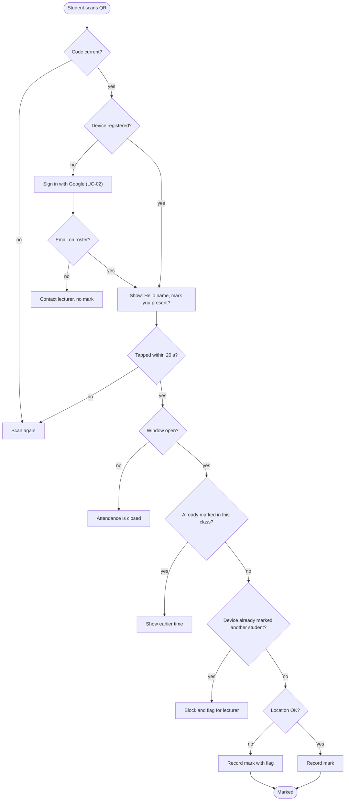

# Use Cases

Status: draft. Last updated: 18/11/2026. Read with `decisions.md` (D1-D20).

## Conventions

- **Lecturer** actions need the lecturer password (D14). **Student** pages for comments and polls need no sign-in (D7, D10, D11).
- Numbers marked "initial" are starting values, to be calibrated: 2-minute window, QR rotation 5-10 s, 20 s to submit, 5% count gap, 300 characters, 10 s between comments, refresh 20 s.
- A class session is created automatically from the date (D19).

## Use cases

| ID | Name | Actor | Feature |
|---|---|---|---|
| UC-00 | Load the course roster | Lecturer | F1 |
| UC-01 | Run an attendance window | Lecturer | F1 |
| UC-02 | Register device | Student | F1 |
| UC-03 | Mark attendance | Student | F1 |
| UC-04 | Check the count with a class photo | Lecturer | F1 |
| UC-05 | Handle exceptions and export | Lecturer | F1 |
| UC-06 | Send a comment | Student | F2 |
| UC-07 | Read and manage comments | Lecturer | F2 |
| UC-08 | Run a poll | Lecturer | F3 |
| UC-09 | Answer a poll | Student | F3 |
| UC-10 | Summarize a lecture | Lecturer | F4 |
| UC-11 | Check my repo | Student | F5 |
| UC-12 | Review the class repos | Lecturer | F5 |
| UC-13 | Edit the review checklist | Lecturer | F5 |

## UC-00 Load the course roster

**Actor:** Lecturer
**Preconditions:** The lecturer has the Moodle participants export (CSV or XLSX).

**Main flow**
1. The lecturer opens the Roster page and uploads the file.
2. The system reads only the first name, last name and email columns, ignores the others, and shows the number of students and the first rows.
3. The lecturer removes rows that are not students (for example staff) and confirms.
4. The system saves the roster on the server only.

**Alternative flows**
- 2a. A required column is missing or the format is wrong: the system names the problem and saves nothing.
- 2b. Duplicate emails: the system lists them and saves nothing.
- 4a. A roster already exists: it is replaced, and earlier attendance rows are kept.

**Postconditions:** The roster exists on the server. It is never committed to the repo.

## UC-01 Run an attendance window

**Actor:** Lecturer
**Preconditions:** The roster is loaded. The projector shows the lecturer page.

**Main flow**
1. At the end of the class the lecturer opens today's session and taps "Open attendance".
2. The system starts a 2-minute window and shows a full-screen QR that changes every 5-10 s, with a countdown and a live count of marks.
3. Students mark attendance (UC-03).
4. The window ends by itself, or the lecturer taps "Close".
5. The system rejects further scans ("Attendance is closed") and shows the totals: marks and flags.
6. The lecturer continues with UC-04 and UC-05.

**Alternative flows**
- 1a. No session exists for today: the system creates one with today's date.
- 1b. The session already has a closed window: the system asks whether to start a new session (for example a tutorial) and its name (D19).
- 2a. The page loses its connection: it reconnects and the QR resumes.
- 4a. The lecturer closes early.

**Postconditions:** The window is closed and no QR is valid. All marks are stored.

## UC-02 Register device

**Actor:** Student
**Preconditions:** The student is on the roster and reached the sign-in page from UC-03.

**Main flow**
1. The student taps "Sign in with Google" and chooses an account.
2. The system receives the verified email and finds it on the roster.
3. The system links this browser to the roster entry and shows "Hello <name>, you are registered".
4. The student continues with UC-03, step 3.

**Alternative flows**
- 1a. Google sign-in is blocked in this browser (an in-app browser): the page says "Open in Chrome or Safari". To be verified in spike S1.
- 1b. The student cancels: no registration.
- 2a. The email is not on the roster: the student is told to contact the lecturer. No registration.
- 3a. This browser was already linked to another student: it is linked to the new one and the lecturer gets a flag "one device, two identities".
- 3b. The student already has another device: this device is added and the lecturer gets a "new device" flag (D16).

**Postconditions:** The browser is linked to one roster entry. No ID number is stored.

## UC-03 Mark attendance

**Actor:** Student in class
**Preconditions:** The lecturer opened an attendance window (UC-01). The student is on the roster.

**Main flow**
1. The student scans the rotating QR code on the projector.
2. The system checks that the code is current (this window or the previous one) and opens the mark page.
3. The system recognizes the registered device and shows: "Hello <name>. Mark you present?"
4. The student taps "I'm here" within about 20 seconds of the scan.
5. The system checks that this roster entry was not marked in this class, that this device did not mark another student, and the location.
6. The system records the mark and shows "Marked at HH:MM".

**Alternative flows**
- 2a. The code is expired: the page asks the student to scan again.
- 3a. The device is not registered: the student signs in with Google (UC-02), then continues at step 3.
- 3b. The email is not on the roster: the student is told to contact the lecturer. No mark. The lecturer can add or edit the entry (UC-05).
- 4a. More than 20 seconds passed: scan again.
- 5a. Already marked: the system shows the earlier time. No second mark.
- 5b. The window is closed: "Attendance is closed; ask the lecturer."
- 5c. This device already marked another student in this class: the attempt is blocked and flagged for the lecturer (D16).
- 5d. Location is out of range or permission is denied: handled per D9. Block or flag is open until spike S3; for now the mark is recorded with a flag.

**Postconditions:** One attendance row exists: roster entry, class, time, source "self", flags (if any). Only a yes/no location is stored.

**How a mark is tied to a person (association):** Google confirms the email. The email is matched to one roster entry. A browser cookie links the device to that entry. Each mark stores the roster entry, never a typed name or ID.

## UC-04 Check the count with a class photo

**Actor:** Lecturer
**Preconditions:** The attendance window is closed. The lecturer took a class photo.

**Main flow**
1. The lecturer uploads the photo on the attendance page.
2. The system counts the people in it (people only, no faces identified).
3. The system compares the count with the number of marks.
4. If the marks exceed the count by more than 5%, the system shows an alert (for example "Marks 104, counted 97, gap 7") and lists the flagged marks first. Otherwise it shows "No gap".
5. The system deletes the photo.
6. The lecturer continues with UC-05.

**Alternative flows**
- 1a. The upload fails or the file is too large: the system shows an error.
- 2a. The count fails: the lecturer can type a count by hand.
- 4a. The count is higher than the marks: no alert. The lecturer can add missing students (UC-05).
- 4b. There is a gap but no flagged mark: the alert is shown and the list stands (D18).

**Postconditions:** The count and the gap are stored with the session. The photo is deleted.

## UC-05 Handle exceptions and export

**Actor:** Lecturer
**Preconditions:** An attendance window was opened for the session (UC-01).

**Main flow**
1. The lecturer opens the session's attendance table: name, time, source, flags, status.
2. If the count alert fired, the system lists the flagged marks first.
3. The lecturer checks the flagged students in class, for example by calling their names.
4. The lecturer marks as "unverified" those who do not answer.
5. The lecturer adds a late student by picking the name from the roster. The system records a mark with source "manual".
6. The lecturer taps "Export". The system creates a spreadsheet file (name, email, time, source, status, flags) and downloads it.

**Alternative flows**
- 3a. No mark is flagged: the list stands (D18).
- 4a. The lecturer returns an "unverified" entry to normal.
- 5a. The student is not on the roster: the lecturer adds the student (name and email) first.
- 5b. The student already has a mark: the system says so.
- 5c. A student's roster email is not a Google account: the lecturer edits the email.
- 5d. The lecturer removes ("resets") a mark so the student can mark again.
- 6a. The export fails: the system shows an error and the table stays.

**Postconditions:** Statuses are updated and the file is downloaded. Nothing is penalized automatically.

## UC-06 Send a comment

**Actor:** Student
**Preconditions:** The student has the class link (the fixed QR or the link). A class session exists (today's, or the latest one).

**Main flow**
1. The student opens the class page.
2. The system shows a comment box and the comments this browser already sent.
3. The student writes a comment and taps "Send".
4. The system checks the length and the sending rate, and stores the comment with the time and the session, with no identity.
5. The system shows "Sent" and adds the comment to the student's list.

**Alternative flows**
- 2a. No class session exists yet: the page says "No class yet".
- 3a. The comment is empty or longer than 300 characters: the system shows an error and keeps the text.
- 4a. The last comment from this browser was less than 10 seconds ago: the system says "Wait a moment" and keeps the text.
- 4b. There is no connection: the text is kept in the browser with a "Retry" button, and is sent when the student taps it, also after class.
- 4c. No session is active (the class ended): the comment is stored in the latest session.

**Postconditions:** The comment is stored anonymously with its time and session. It appears on the lecturer's page.

## UC-07 Read and manage comments

**Actor:** Lecturer
**Preconditions:** The lecturer is signed in.

**Main flow**
1. The lecturer opens the Comments page. It shows the current session, or the latest one.
2. The system lists the comments, newest first. It refreshes every 20 seconds, and a "Refresh now" button is available.
3. The lecturer reads the comments and decides whether to repeat a topic.
4. The lecturer taps "Hide" on an inappropriate comment.
5. The system hides it from the list and shows the number of hidden comments.

**Alternative flows**
- 1a. Not signed in: the system asks for the password. A wrong password gives an error, and repeated tries are limited.
- 2a. The connection drops: the page shows "Offline" and resumes by itself.
- 4a. The lecturer taps "Delete": after confirmation the comment is removed permanently.
- 4b. The lecturer taps "Delete all" for the session: after confirmation all its comments are removed.
- 4c. The lecturer taps "Show" on a hidden comment: it returns to the list.

**Postconditions:** Hidden or deleted comments do not appear. The rest are kept until the end of the semester.

## UC-08 Run a poll

**Actor:** Lecturer
**Preconditions:** The lecturer is signed in. A class session exists (today's).

**Main flow**
1. The lecturer opens the Polls page, enters a question and 2-4 options, and may mark one option as correct.
2. The lecturer taps "Start" and tells the class that a poll started.
3. The system publishes the poll on the class page and shows the lecturer the live count per option (refreshed every few seconds while the poll is open).
4. Students answer (UC-09).
5. The lecturer taps "Close".
6. The system stops accepting answers and shows the final results: count and percent per option, and, if a correct option was marked, how many were right and wrong. The lecturer may project the page.

**Alternative flows**
- 1a. The question is empty, or there are fewer than 2 or more than 4 options: the system shows an error.
- 2a. Another poll is open: the system closes it, keeps its results, and starts the new one.
- 3a. The connection drops: the page shows "Offline" and resumes by itself.
- 6a. The lecturer taps "Delete" on a poll: after confirmation its results are removed.

**Postconditions:** The poll is closed. Its results are kept until the end of the semester or until deleted.

## UC-09 Answer a poll

**Actor:** Student
**Preconditions:** The student has the class page open (the fixed QR or the link). The lecturer announced that a poll started.

**Main flow**
1. The student opens or refreshes the class page.
2. The system shows the active poll: the question and the options.
3. The student taps an option.
4. The system records one anonymous answer for this browser and shows "Thanks. When the lecturer closes the poll, refresh to see the result".
5. After the lecturer closes the poll, the student refreshes the page. The system shows the result. If a correct option was marked: "Correct" or "Wrong" and the right answer. Otherwise: the class distribution.

**Alternative flows**
- 2a. No poll is active: the page says "No question now. Refresh when the lecturer announces one".
- 3a. This browser already answered this poll: the page shows "You answered" and accepts no new answer.
- 3b. The poll closed before the student answered: the page shows the results.
- 3c. There is no connection: the choice is kept in the browser with a "Retry" button, and is sent if the poll is still open.

**Postconditions:** One answer is stored with a random browser id, not an identity. It cannot be changed.

## UC-10 Summarize a lecture

**Actor:** Lecturer
**Preconditions:** The lecturer is signed in. A class session exists. The lecturer has a Zoom transcript (VTT preferred, or txt) or, if none, a recording.

**Main flow**
1. The lecturer opens the Lecture summary page and chooses the session (the latest by default).
2. The lecturer uploads the file and taps "Summarize".
3. The system checks the type and size, starts a background job, and shows "Processing". The page refreshes every 20 seconds.
4. For a transcript the system sends the text to a language model with a fixed format. For a recording it first extracts the audio, splits it, transcribes each part and joins them.
5. The system stores the summary and deletes the uploaded file.
6. The lecturer sees the summary: a short summary, chapters with timestamps, keywords, a "related to" line (from this transcript only), the date and the length.
7. The lecturer copies the text or downloads it as a file.

**Alternative flows**
- 2a. Unsupported type or too large: the system shows an error and stores nothing.
- 4a. The model fails or does not respond: the status is "Failed" with a "Retry" button.
- 4b. A txt file has no timestamps: the summary has no chapters, with a note.
- 4c. The VTT file is empty or damaged: the system shows an error.
- 4d. Transcribing a recording fails or takes too long: the status is "Failed".
- 6a. The lecturer deletes the summary.

**Postconditions:** The summary is kept until the end of the semester. The uploaded file is deleted.

## UC-11 Check my repo

**Actor:** Student
**Preconditions:** The student has the class link. A checklist exists (UC-13).

**Main flow**
1. The student opens the Check page and pastes the link to the repo.
2. The system cleans the link and applies the limits: one report per minute per browser, and a daily cap for the whole system.
3. The system checks that the repo is accessible, then reads its file list and README.
4. Layer 1 (code, no AI): for each checklist item the system looks for a file whose name contains the item's word, and checks the links in the README.
5. Layer 2 (language model): the system rates each checklist topic in the README (absent, brief, detailed), compares with the class counts if the lecturer ran UC-12, and writes 3-5 remarks.
6. The system shows the report: checks, comparison, remarks. It marks what was checked by code and what by a model that may be wrong.
7. The student can download the report.

**Alternative flows**
- 1a. The link is not valid: the system shows an error.
- 2a. Less than a minute since the last report: "Wait a moment".
- 2b. The daily cap is reached: "Try again tomorrow".
- 3a. The repo is private or not found: the report says so.
- 3b. GitHub limits requests or is down: "Try again later".
- 4a. A link to Drive or OneDrive needs permission: the report says "cannot verify", not "broken".
- 5a. The model fails: the report has layer 1 only.
- 5b. The lecturer has not run UC-12: there is no class comparison.
- 5c. The README is very long: it is cut. Text in it that tries to instruct the model is treated as data.

**Postconditions:** Nothing is stored except the counters for the limits. The report is not stored.

## UC-12 Review the class repos

**Actor:** Lecturer
**Preconditions:** The lecturer is signed in. A checklist exists (UC-13).

**Main flow**
1. The lecturer opens the Submissions page and uploads the list file (the form responses export).
2. The system reads only the repo link column, cleans the links, removes duplicates, and shows the number of links. The lecturer confirms.
3. The lecturer taps "Run review". The system works in the background and shows progress ("12 of 25"). The page refreshes every 20 seconds.
4. For each repo the system runs layer 1 and has a model rate the README topics.
5. The system stores the per-repo results and the class counts.
6. The lecturer sees a table: one row per repo, with a mark for each checklist item, flags (private, no README, README short) and topic ratings. It can be sorted and filtered.
7. The lecturer exports the table to a file.

**Alternative flows**
- 1a. The format is wrong or there is no link column: the system shows an error and saves nothing.
- 2a. Some links are not valid: they are listed as "invalid" and skipped.
- 4a. A repo is private or not found: its row is flagged and the run continues.
- 4b. The model fails for a repo: its row has layer 1 only.
- 4c. The lecturer stops the run: the finished rows stay.
- 6a. The lecturer deletes the overview.

**Postconditions:** The overview is kept until the end of the semester. No emails are stored.

## UC-13 Edit the review checklist

**Actor:** Lecturer
**Preconditions:** The lecturer is signed in.

**Main flow**
1. The lecturer opens the Checklist page. It shows the current list, pre-filled for the demo from the Ex1 To Do (README with problem and scope, SRS, algorithm description, data description, test strategy, experiment report).
2. The lecturer edits it in a text box, one item per line, with the word to look for. A minimum length may be added to a line.
3. The lecturer taps "Save".
4. The system validates the list and saves it.

**Alternative flows**
- 3a. A line is not valid or the list is empty: the system shows the line number and saves nothing.
- 3b. The lecturer taps "Reset": the pre-filled list returns.

**Postconditions:** The checklist is saved and used by UC-11 and UC-12.

## Known limits

- A student who gives a friend their Google password and code can have the friend marked from a second device. The photo count is the safety net.
- The device block uses a cookie. A private window or cleared cookies bypass it; the new-device flag helps.
- Anyone with the fixed class link can send comments or answer polls, also from outside the class.
- A poll answer is one per browser, so a second browser can answer again.
- Language-model output may be wrong, and is marked as such.
- The daily cap of F5 can be used up by one person.